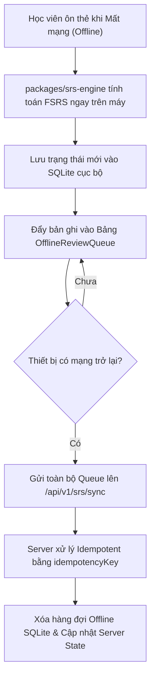

# LinguaFlow — Cẩm Nang Kỹ Thuật Frontend Toàn Cục (FE Global Skill)

Tài liệu này quy chuẩn toàn bộ kiến trúc giao diện, quản lý trạng thái, tương tác người dùng và cơ chế đồng bộ ngoại tuyến cho cả hai nền tảng Frontend của **LinguaFlow**: **Web App / PWA** (`apps/web`) và **Mobile App** (`apps/mobile`).

---

## 1. Bản Đồ Kiến Trúc Hai Đầu Frontend

```text
Frontend Ecosystem
├── apps/web/                    # Next.js 15 App Router + React 19 + Tailwind CSS + shadcn/ui
│   ├── src/app/
│   │   ├── (auth)/              # Đăng ký, đăng nhập, quên mật khẩu
│   │   ├── learn/               # Lộ trình bài học, màn hình làm Quiz tương tác
│   │   ├── flashcards/          # Ôn tập từ vựng ngắt quãng (SRS Deck Viewer & 3D Flip)
│   │   ├── leaderboard/         # Bảng xếp hạng tuần theo League (Bronze, Silver, Gold...)
│   │   ├── shop/                # Cửa hàng vật phẩm (Streak Freeze, Nạp Tim, Trang phục Linh vật)
│   │   ├── speaking/            # Phòng luyện nói thời gian thực với AI Speaking Partner
│   │   └── admin/               # Bảng điều khiển quản trị (Analytics, Khóa học, Từ vựng, Users)
│   ├── src/components/          # UI Components dùng chung (Button, Modal, ProgressBar, HeartIndicator)
│   ├── src/lib/                 # API Client (Ky/Axios), Audio Helper, Utils (cn)
│   └── src/store/               # Zustand Client Stores (UI state, Active Session)
│
├── apps/mobile/                 # React Native + Expo SDK 52+ + Offline SQLite
│   ├── app/                     # File-based routing (Expo Router)
│   ├── components/              # Native UI Components (FlashList, Gesture Handlers, Waveform)
│   ├── services/
│   │   ├── api.ts               # HTTP Client kết nối Backend API
│   │   ├── offline-srs.service  # Động cơ ôn tập ngoại tuyến & hàng đợi đồng bộ SQLite
│   │   └── notification.service # Quản lý nhắc nhở học tập cục bộ & Push Notifications
│   └── test/                    # Unit tests cho logic mobile & offline sync
│
└── packages/ (Shared Logic)
    ├── @linguaflow/shared-types # Zod Schemas & TypeScript DTOs
    └── @linguaflow/srs-engine   # Thuật toán FSRS v4 / SM-2 chạy trực tiếp tại Client
```

---

## 2. Quản Lý Trạng Thái (State Management Strategy)

Để tránh tình trạng phân mảnh và quá tải state, Frontend áp dụng quy tắc phân tách nghiêm ngặt:

### 2.1. Server State: TanStack Query v5 (`@tanstack/react-query`)
- **Phạm vi**: Mọi dữ liệu đến từ Backend API (Danh sách bài học, thông tin từ vựng, điểm số bảng xếp hạng, tiến trình người dùng).
- **Cấu hình chuẩn**:
  - `staleTime`: 1 đến 5 phút cho dữ liệu ít biến động (nội dung khóa học, từ điển).
  - `staleTime: 0` cho dữ liệu thay đổi liên tục (bảng xếp hạng trực tiếp, số tim còn lại).
- **Optimistic Updates (Cập nhật giao diện lập tức)**:
  - Khi người dùng đánh giá thẻ Flashcard (`Again`, `Hard`, `Good`, `Easy`): Chuyển sang thẻ tiếp theo ngay trên UI, đồng thời gửi request ngầm. Nếu gặp sự cố mạng, hoàn tác (rollback) trạng thái và thông báo cho người dùng.
  - Khi mua vật phẩm trong Shop: Trừ tiền ảo/gems lập tức trên UI trước khi server phản hồi.

### 2.2. Client State: Zustand Stores
- **Phạm vi**: Chỉ lưu trữ trạng thái giao diện tức thời hoặc phiên tương tác ngắn hạn:
  - `useAuthStore`: Lưu Access Token tạm thời trên bộ nhớ RAM (Web) hoặc SecureStore (Mobile).
  - `useGameStore`: Trạng thái bài học hiện tại (Câu hỏi hiện tại, số tim tạm thời, âm thanh bật/tắt).
  - `useAudioStore`: Trạng thái ghi âm, mức âm lượng microphone, visualizer sóng âm.
- **Quy tắc vàng**: Tuyệt đối **không** sao chép dữ liệu từ TanStack Query vào Zustand store để tránh hiện tượng lệch pha dữ liệu (stale data).

### 2.3. Form Validation: React Hook Form + Zod
- Mọi form nhập liệu (Đăng ký, Đổi mật khẩu, Tạo từ vựng mới) đều phải sử dụng:
  ```typescript
  import { useForm } from 'react-hook-form';
  import { zodResolver } from '@hookform/resolvers/zod';
  import { loginSchema, LoginDto } from '@linguaflow/shared-types';

  const { register, handleSubmit, formState: { errors } } = useForm<LoginDto>({
    resolver: zodResolver(loginSchema),
  });
  ```

---

## 3. Quy Chuẩn Thiết Kế Giao Diện & Gamification Tương Tác Cao

### 3.1. Phong Cách Thiết Kế Gamification (Duolingo-style)
- **Thanh Tiến Trình (Lesson Progress Bar)**: Động, chuyển màu mượt mà khi trả lời đúng từng câu, đạt 100% khi kết thúc bài học.
- **Hệ Thống Tim (Hearts / Lives)**:
  - Hiển thị trực quan góc trên cùng màn hình.
  - Khi trả lời sai: Kích hoạt hiệu ứng rung lắc (shake animation) kèm trừ 1 tim đỏ thành tim xám.
  - Khi còn 0 tim: Hiển thị BottomSheet/Modal thông báo hết tim, gợi ý ôn tập thẻ cũ để hồi phục tim miễn phí hoặc mua tim trong Shop.
- **Hiệu Ứng Lửa Streak (Streak Flames)**:
  - Hoạt ảnh lửa rực rỡ khi hoàn thành mốc học ngày hôm nay.
  - Đếm số ngày liên tục kèm huy hiệu tương ứng.
- **Trải Nghiệm Thẻ Flashcard**:
  - Hỗ trợ lật thẻ 3D (3D Flip Animation) hiển thị mặt trước (từ vựng + IPA + nút phát âm) và mặt sau (nghĩa, ví dụ, hình ảnh minh họa).
  - Trên Mobile: Hỗ trợ cử chỉ vuốt (Gesture Swipe) bằng `react-native-gesture-handler`.

### 3.2. Âm Thanh & Phản Hồi Xúc Giác (Audio & Haptics)
- **Web**: Dùng HTML5 Audio / Web Audio API cho hiệu ứng âm thanh nhẹ (`success.mp3`, `error.mp3`, `level-up.mp3`).
- **Mobile**:
  - Tích hợp `expo-haptics`: Rung nhẹ khi chạm nút chọn đáp án, rung thành công (`Haptics.notificationAsync(Success)`) khi đúng, và rung cảnh báo (`Haptics.notificationAsync(Error)`) khi sai.

---

## 4. Cơ Chế Ngoại Tuyến & Đồng Bộ Dữ Liệu (Offline-First Mobile)

Hệ thống Mobile được thiết kế để học viên vẫn có thể học từ vựng khi đang trên máy bay hoặc mất sóng:



- **Quy tắc Idempotency**: Mỗi lượt ôn thẻ sinh một `idempotencyKey` ngẫu nhiên (UUID v4) tại client. Khi đồng bộ lại, server kiểm tra key này để đảm bảo không cộng dồn điểm XP hoặc tính sai khoảng thời gian ôn tập nhiều lần.

---

## 5. Tương Tác Giọng Nói & AI Speaking Partner

- **Ghi Âm**:
  - Web: Sử dụng `navigator.mediaDevices.getUserMedia` kết hợp `MediaRecorder` chuẩn hóa audio chunk.
  - Mobile: Sử dụng `expo-av` hoặc `expo-audio` với chuẩn nén m4a/wav tối ưu băng thông.
- **Hiển Thị Sóng Âm (Waveform Visualizer)**:
  - Phân tích tần số âm thanh từ microphone qua `AudioContext.createAnalyser()` để hiển thị các cột sóng âm nhảy theo giọng nói của học viên.
- **WebSocket Streaming**:
  - Thiết lập kết nối thời gian thực tới `/speaking` gateway.
  - Truyền tải âm thanh nén, nhận phản hồi dạng văn bản kèm audio stream từ Google Gemini và phát lại mượt mà không bị ngắt quãng.

---

## 6. Hiệu Năng & Khả Năng Tiếp Cận (Performance & Accessibility)

1. **Ảo Hóa Danh Sách Dài (Virtualization)**:
   - Trên Web: Bắt buộc dùng `@tanstack/react-virtual` cho bảng từ vựng hàng nghìn từ và bảng xếp hạng người dùng.
   - Trên Mobile: Sử dụng `@shopify/flash-list` thay cho `FlatList` mặc định để đạt 60fps mượt mà khi cuộn danh sách lớn.
2. **Tối Ưu Tải Tài Nguyên**:
   - Sử dụng `next/image` trên Web và nén ảnh đại diện/minh họa dạng WebP.
   - Toàn bộ file audio mẫu phát âm được lưu trữ trên CDN/MinIO với cơ chế cache `Cache-Control: public, max-age=31536000`.
3. **Chuẩn Trợ Năng (Accessibility - a11y)**:
   - Các nút bấm phải có diện tích chạm tối thiểu $44 \times 44\text{px}$.
   - Khai báo đầy đủ `aria-label` cho các biểu tượng icon (ví dụ: nút loa phát âm, nút đóng modal).
   - Độ tương phản màu sắc văn bản đạt chuẩn tối thiểu WCAG AA ($4.5:1$).

---

## 7. Quy Chuẩn Kiểm Thử Frontend (Testing)

```bash
# Kiểm thử đơn vị các Component và Hooks trên Web
pnpm --filter @linguaflow/web test

# Kiểm thử dịch vụ ngoại tuyến và Logic trên Mobile
pnpm --filter @linguaflow/mobile test

# Kiểm tra định dạng mã nguồn và Types
pnpm --filter @linguaflow/web lint
pnpm --filter @linguaflow/mobile tsc --noEmit
```
