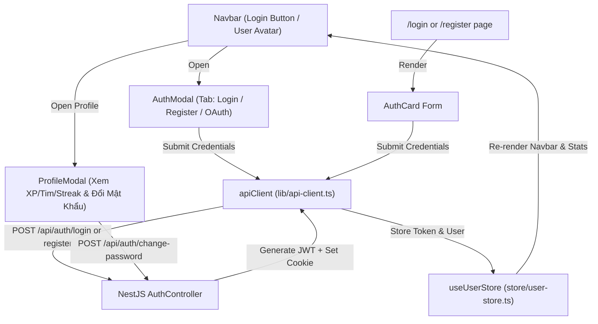

# Kế hoạch Triển Khai Tính Năng Xác Thực Toàn Diện (Phase 09: User Authentication UI & OAuth)

## 1. Bối cảnh & Mục tiêu
- **Mục tiêu**: Xây dựng trải nghiệm xác thực người dùng toàn diện cho LinguaFlow Web (Next.js 15 + React 19 + Tailwind CSS) kết nối đồng bộ với backend NestJS JWT + Argon2id + Redis.
- **Tiêu chí**:
  - Hỗ trợ cả 2 phương thức hiển thị: **Auth Modal** (bật nhanh trên bất kỳ trang nào) và **Trang độc lập** (`/login`, `/register`).
  - Hỗ trợ **Đăng nhập bằng Email & Mật khẩu**, **Đăng ký tài khoản mới**, **Đăng nhập 1-click Demo**, và **Social OAuth (Google & Facebook)**.
  - Quản lý phiên học trên Navbar: Avatar người dùng, thông tin cấp độ/XP, menu Dropdown với **Hồ sơ & Đổi mật khẩu** và **Đăng xuất**.

---

## 2. Kiến trúc & Touchpoints

---

## 3. Các bước thực hiện chi tiết

### Bước 1: Mở rộng Backend API (OAuth Dev Flow)
- File: `apps/api/src/auth/auth.controller.ts` & `apps/api/src/auth/auth.service.ts`
- Thêm endpoint `POST /api/auth/oauth`: nhận `{ provider: "google" | "facebook", email, displayName, avatarUrl }`, tự động tìm hoặc tạo user với `role: USER`, cấp JWT token và lưu refresh token.
- Viết unit test cho OAuth dev endpoint.

### Bước 2: Cập nhật Web Store & API Client
- File: `apps/web/src/store/user-store.ts`
  - Thêm `isAuthenticated: boolean`, `user: any | null`, `authModalOpen: boolean`, `authModalTab: "login" | "register"`, `openAuthModal()`, `closeAuthModal()`, `loginUser()`, `logoutUser()`.
- File: `apps/web/src/lib/api-client.ts`
  - Bổ sung `oauthLogin(provider, email, name, avatar)` và `getCurrentUser()`.

### Bước 3: Xây dựng Auth Modal & Social OAuth Buttons
- File: `apps/web/src/components/auth/auth-modal.tsx`
  - Giao diện cao cấp, mượt mà (smooth animations, backdrop blur).
  - Tabs: **Đăng Nhập** & **Đăng Ký**.
  - Form validation: Email format, độ dài mật khẩu (>= 8 ký tự), hiển thị/ẩn mật khẩu.
  - Nút **"Đăng nhập với Google"** và **"Đăng nhập với Facebook"**.
  - Nút **"Đăng nhập nhanh tài khoản Mẫu (Demo Learner)"** giúp kiểm thử ngay lập tức.
  - Thông báo lỗi trực quan (toast/alert box) khi sai mật khẩu hoặc email đã tồn tại.

### Bước 4: Xây dựng Trang Độc Lập `/login` & `/register`
- File: `apps/web/src/app/login/page.tsx`
- File: `apps/web/src/app/register/page.tsx`
- Tái sử dụng component form xác thực với chế độ fullscreen, có điều hướng chuyển đổi qua lại và redirect về `/learn` sau khi thành công.

### Bước 5: Cập nhật Navbar & Dropdown Menu & Profile Modal
- File: `apps/web/src/components/layout/navbar.tsx`
  - Khi chưa đăng nhập: Hiển thị nút **"Đăng Nhập"** (viền emerald) và **"Bắt Đầu Học"** (nền xanh emerald).
  - Khi đã đăng nhập: Hiển thị Avatar tròn (hoặc chữ cái đầu), tên người dùng, huy hiệu League/Level.
  - Dropdown Menu:
    - Xem Hồ Sơ & Thống Kê
    - Đổi Mật Khẩu
    - Đăng Xuất (gọi `apiClient.logout()`, xóa token, khôi phục trạng thái guest).
- File: `apps/web/src/components/auth/profile-modal.tsx`:
  - Tab 1: Thông tin cá nhân, cấp độ, XP, chuỗi Streak, số Tim hiện có.
  - Tab 2: Đổi mật khẩu an toàn (`Mật khẩu hiện tại`, `Mật khẩu mới`, `Xác nhận mật khẩu`).

### Bước 6: Kiểm thử E2E & Verification
- Chạy `pnpm test` (đảm bảo 100% test pass).
- Chạy `pnpm build` (đảm bảo Next.js compile thành công 16 route tĩnh).
- Xác minh luồng: Đăng nhập -> Navbar đổi trạng thái -> Làm bài học -> Đổi mật khẩu -> Đăng xuất.
